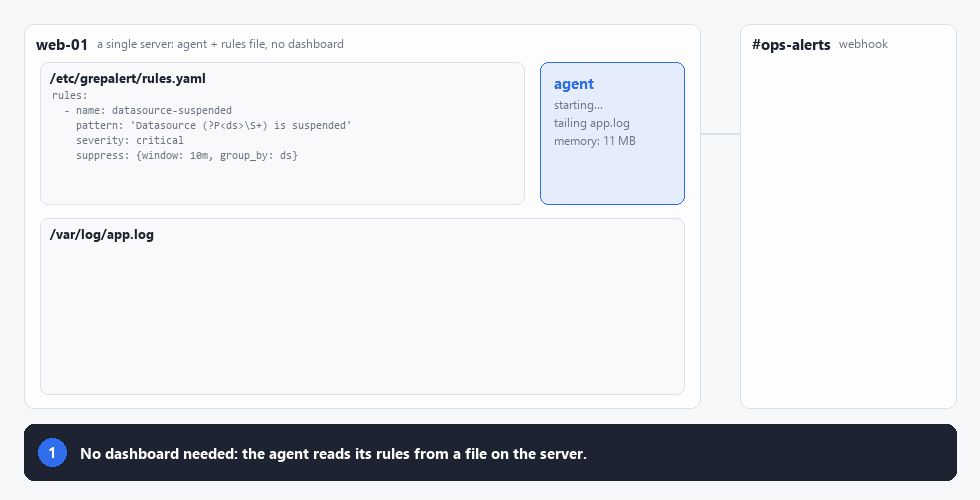
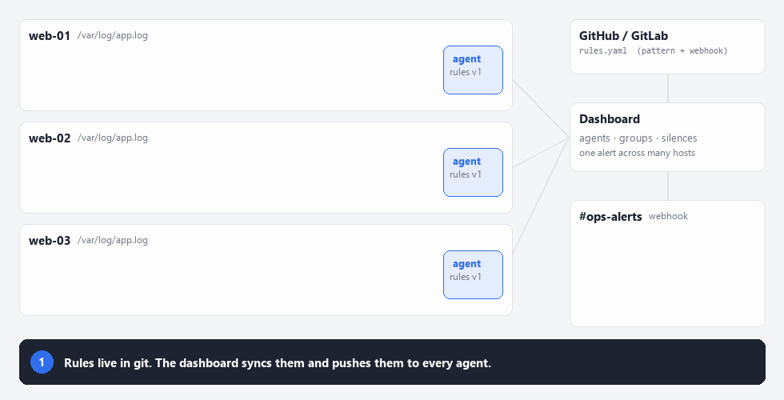
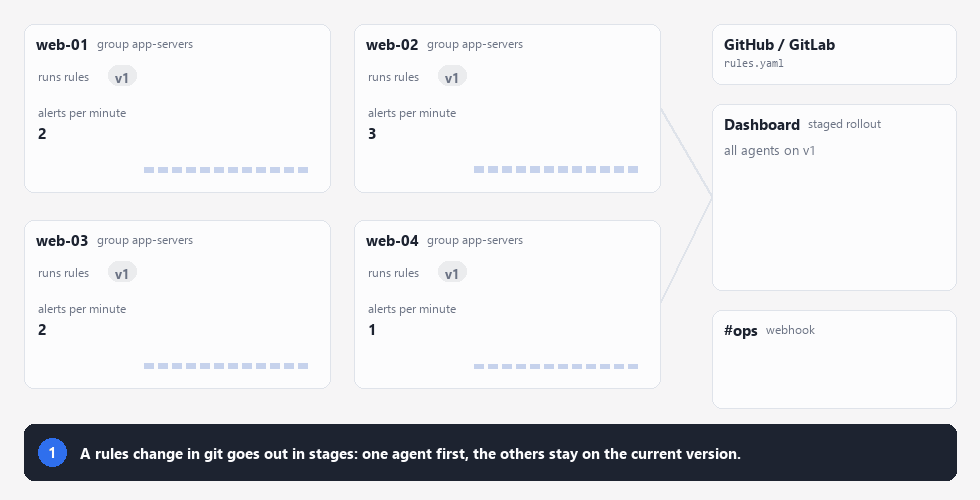

# grepalert

**Alerts from your logs in five minutes. No Loki, no Elasticsearch, no database.**

Tail a file or the pods a Kubernetes label selector picks, match a pattern, post a clean message to Slack, Teams or any webhook. Run it on one server, or manage a whole fleet from the dashboard.

**On its own.** One agent and a rules file on the server is all it takes:



**With the dashboard.** Manage many agents: rules come from git, and the same alert from many servers becomes one:



It is two static Go binaries with no database and no queue:

| Binary | Runs on | Job |
|---|---|---|
| `grepalert-agent` | every server with logs | Tails files, matches rules, suppresses floods, sends webhooks. Rules hot-reload with no restart. |
| `grepalert-dashboard` | anywhere | Web UI: connect agents, put them in groups that share one rule set (edited in the UI or synced from GitHub/GitLab), and monitor them. |

```
            GitHub / GitLab (rules.yaml)
                       │  fetch (manual or every N min)
                       ▼
 browser ──► grepalert-dashboard ──PUT /api/v1/rules──► grepalert-agent ──► webhook (Slack, Discord, …)
             (agents, groups)  ◄── GET status / events ──       │
                                                          tails /var/log/*.log
```

## When rules change, or the dashboard fails

**Staged rollout.** A rule change can reach a group in stages. If the agents on the new version alert far more than the others, the rollout stops itself and everyone goes back. See [Safe rule rollout](docs/rollout.md).



**If the dashboard goes down.** Agents keep alerting. They work from the rules, read positions and silences on their own disk, even across a restart:


## Install

**Binaries.** Download an archive for Linux, macOS or Windows (amd64/arm64) from [Releases](https://github.com/FadhlanHawali/grepalert/releases). Each archive holds both programs plus example configs:

```bash
curl -fsSLO https://github.com/FadhlanHawali/grepalert/releases/download/v0.1.0/grepalert_0.1.0_linux_amd64.tar.gz
tar xzf grepalert_0.1.0_linux_amd64.tar.gz && cd grepalert_0.1.0_linux_amd64
./grepalert-agent -version
```

The dashboard's web UI is embedded in its binary, so each program is a single static file with no dependencies. `checksums.txt` on the release page lists the SHA-256 of every archive.

**Containers.** Images for linux/amd64 and linux/arm64 are on GitHub Container Registry:
- **Dashboard:** start it on http://localhost:9400 and sign in as `admin`:

  ```bash
  docker run -d --name grepalert-dashboard -p 9400:9400     -e GREPALERT_DASHBOARD_PASSWORD=change-me-please     -e GREPALERT_ENROLL_TOKEN=$(openssl rand -hex 16)     -v grepalert-dashboard:/var/lib/grepalert-dashboard     ghcr.io/fadhlanhawali/grepalert-dashboard:0.1.0
  ```
- **Agent, connected to that dashboard:** it enrolls itself and gets its rules from a group. Use the same enrollment token as the dashboard:

  ```bash
  docker run -d --name grepalert-agent     -e GREPALERT_DASHBOARD_URL=http://dashboard-host:9400     -e GREPALERT_ENROLL_TOKEN=<the same token>     -v /var/log:/var/log:ro -v grepalert-agent:/var/lib/grepalert     ghcr.io/fadhlanhawali/grepalert-agent:0.1.0
  ```
- **Agent, standalone:** put your `rules.yaml` in a folder and mount it at `/var/lib/grepalert`. It is reloaded when you edit it:

  ```bash
  docker run -d --name grepalert-agent     -e SLACK_WEBHOOK_URL=https://hooks.slack.com/...     -v $PWD/grepalert:/var/lib/grepalert -v /var/log:/var/log:ro     ghcr.io/fadhlanhawali/grepalert-agent:0.1.0
  ```

Both images read a built-in config driven by these environment variables ([agent](examples/container/agent.yaml), [dashboard](examples/container/dashboard.yaml)). Mount your own file at `/etc/grepalert/agent.yaml` or `/etc/grepalert/dashboard.yaml` for labels, SSO, TLS and everything else.

**From source.** Building needs Go 1.26+ and, for the dashboard's UI, Node.js 20+:

```bash
make build            # the web UI and both binaries, into bin/
```

The agent alone needs no Node.js: `go build ./cmd/grepalert-agent`.

## Quick start

**Agent**, on each server:

```bash
cp examples/agent.yaml examples/rules.yaml /etc/grepalert/
export GREPALERT_AGENT_TOKEN=$(openssl rand -hex 16) SLACK_WEBHOOK_URL=https://hooks.slack.com/...
grepalert-agent -config /etc/grepalert/agent.yaml
```

That is all a standalone agent needs: no dashboard required.

**Changing a standalone agent's rules.** Edit `rules.yaml` and save. There is nothing to reload and no restart:
- **Picking up changes:** the agent checks the file every `rescan_interval` (10 s by default) and applies a new version on its own. It logs `rules applied`, and files that the new rules add or drop are followed or released.
- **Broken edits:** a file that fails validation is not applied. The agent logs `rules file reload failed, keeping previous rules` with the reason and keeps alerting with the last good rules. Fix the file and save again.
- **Checking before you save:** validate a file first with the same check the agent runs:

  ```bash
  grepalert-agent -check /etc/grepalert/rules.yaml   # exit 0 and "OK: …", or exit 1 and the error
  ```
- **No file access:** `PUT /api/v1/rules` on the agent's API validates, saves and applies in one step (see [Agent API](docs/api.md)).
- **Extra local rules:** `rules.local.yaml` next to `rules.yaml` is reloaded the same way.

**Dashboard**:

```bash
cp examples/dashboard.yaml .
export GREPALERT_DASHBOARD_PASSWORD=...
grepalert-dashboard -config dashboard.yaml     # http://localhost:9400
```

Then, in the UI, create an enrollment token (**Agent enrollment**) for your agents, or connect to them by address (**Connect agent**), and create groups (**New group**).

## Try it with Docker Compose

```bash
cd examples/compose
docker compose up -d --build
```

Open http://localhost:9400 (`admin` / `demo`). Three app servers enroll themselves and join a group whose rules come from a stand-in git repository, with staged rollout on. Alerts arrive at http://localhost:9599. [The demo walkthrough](docs/demo.md) shows what to try. For single sign-on, there is also [a Keycloak example](docs/security.md#sign-in-roles-and-audit-log).

## Documentation

| Topic | What's in it |
|---|---|
| [Demo walkthrough](docs/demo.md) | The Docker Compose demo, step by step |
| [Agents](docs/agents.md) | Enrolling agents, labels, files an agent keeps on disk, groups, the dashboard being down, log rotation, restarts |
| [Dashboard](docs/dashboard.md) | Agents and groups, rules from the UI or GitHub/GitLab, how changes reach agents |
| [Kubernetes](docs/kubernetes.md) | Pod logs picked by a label selector, or log files on a shared volume, as on a VM |
| [Rules](docs/rules.md) | Rule format, suppression, absence rules, webhook payloads and templates, extracting values from a line |
| [Safe rule rollout](docs/rollout.md) | Versions and rollback, staged rollout, dry run, per-machine local rules |
| [Fleet-level alerting](docs/fleet-alerting.md) | One alert across many hosts, silences, agent-down alerts |
| [Security, sign-in and audit log](docs/security.md) | SSO (OIDC) and local accounts, roles, audit log, hardening |
| [Memory and performance](docs/performance.md) | Why the agent's memory stays flat, multi-GB logs, many files, load testing |
| [Agent API](docs/api.md) | The agent's HTTP API |
| [Development](docs/development.md) | Code layout, building, working on the web UI |
| [Releasing](docs/releasing.md) | How a release is cut: release notes, binaries, container images |
| [Release notes](docs/releases/) | What each version brings, one file per release |

## License

Apache License 2.0. See [LICENSE](LICENSE).
